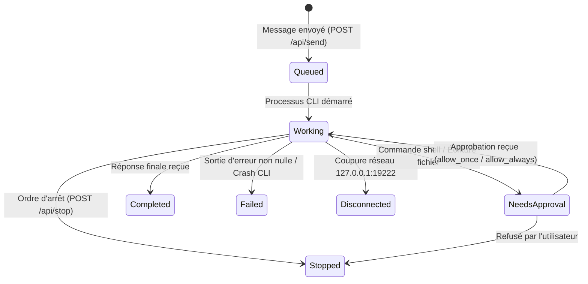

# Architecture des Notifications Système Android — CodeStation

**Date :** 27 Octobre 2026  
**Cible :** Android 8.0 (API 26) à Android 16 (API 35/36)  
**Package :** `com.ghdinteractivestudio.codestation`  

---

## 1. Principes et Exigences Système

1. **Aucune simulation d'interface :** Les notifications ne sont pas des maquettes Compose dessinées sur l'écran, mais de véritables instances `android.app.Notification` transmises au `NotificationManager` Android natif.
2. **Synchronisation événementielle stricte :** Chaque notification est mise à jour par les événements du serveur local (`127.0.0.1:19222`) reçus via le flux SSE (`/events?since=0`).
3. **Persistance et cycle de vie :**
   - Durant l'exécution (`queued`, `working`), la notification est persistante (`ongoing = true`), avec un chronomètre actif (`setUsesChronometer(true)`).
   - En cas de demande d'approbation (`needs_approval`), la notification bascule sur le canal haute priorité avec alerte sonore/vibration et actions directes.
   - À la fin (`completed`, `failed`, `stopped`), la notification devient dissociable (`ongoing = false`, `autoCancel = true`).
4. **Intégration Live Updates (Android 16+) :**
   - Utilisation des catégories `CATEGORY_PROGRESS` et `CATEGORY_STATUS`.
   - Compatibilité avec les puces d'état (Status Bar Chips) et Dynamic Island si supportées par le système hôte.

---

## 2. Canaux de Notification (Notification Channels)

Trois canaux dédiés sont créés au démarrage dans `CodeStationApplication` :

```
┌────────────────────────────────────────────────────────────────────────┐
│ Canaux CodeStation                                                    │
├──────────────────────────┬────────────────┬──────────────┬─────────────┤
│ Identifiant              │ Nom            │ Importance   │ Comportement│
├──────────────────────────┼────────────────┼──────────────┼─────────────┤
│ codestation_live_tasks   │ Tâches en cours│ LOW          │ Persistant, │
│                          │ (Live Updates) │ (Pas de son) │ Chronomètre │
├──────────────────────────┼────────────────┼──────────────┼─────────────┤
│ codestation_approvals    │ Demandes       │ HIGH         │ Heads-up,   │
│                          │ d'autorisation │ (Son/Vibre)  │ Boutons     │
├──────────────────────────┼────────────────┼──────────────┼─────────────┤
│ codestation_completed    │ Tâches         │ DEFAULT      │ Alerte fin, │
│                          │ terminées      │              │ Révocable   │
└──────────────────────────┴────────────────┴──────────────┴─────────────┘
```

---

## 3. Matrice des États de Notification



| État | Canal | Ongoing | Titre Notification | Texte / Résumé | Action Clic |
|---|---|---|---|---|---|
| `queued` | `codestation_live_tasks` | Oui | `[BotName] — En attente` | "Tâche en file d'attente..." | Ouvre la conversation |
| `working` | `codestation_live_tasks` | Oui | `[BotName] — Au travail` | "[Étape actuelle / Outil CLI]" + Chronomètre | Ouvre la conversation |
| `needs_approval` | `codestation_approvals` | Oui | `[BotName] — Autorisation requise` | "[Commande / Action sensible]" | Boutons Approuver / Refuser |
| `completed` | `codestation_completed` | Non | `[BotName] — Tâche terminée` | "Réponse prête à être consultée" | Ouvre la conversation |
| `failed` | `codestation_completed` | Non | `[BotName] — Erreur` | "[Motif d'échec vérifié]" | Ouvre la conversation |
| `stopped` | `codestation_completed` | Non | `[BotName] — Arrêté` | "Tâche interrompue" | Ouvre la conversation |
| `disconnected` | `codestation_completed` | Non | `CodeStation — Connexion perdue` | "Vérifiez que codestation-host écoute sur 127.0.0.1:19222" | Ouvre les paramètres |

---

## 4. PendingIntent et Navigation Directe

Chaque notification est rattachée à un `PendingIntent` vers `MainActivity` avec le flag `FLAG_UPDATE_CURRENT or FLAG_IMMUTABLE`, configuré avec l'URI de navigation interne :
`codestation://chat?botId=<botId>`
Cliquer sur la notification amène immédiatement l'utilisateur sur le fil de discussion du bot concerné, quel que soit l'écran actif.
