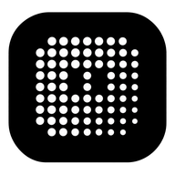

# CodeStation — Native Android AI Agent Hub & Autonomous Coding Environment

<p align="center">
  
</p>

<p align="center">
  <b>Plateforme mobile native Android (Kotlin 2.0 + Jetpack Compose) pour l'orchestration, le monitoring en temps réel et l'interaction avec des agents IA autonomes de développement logiciel.</b>
</p>

<p align="center">
  
  
  
  
  
</p>

---

## 🌟 Présentation

**CodeStation** est un environnement mobile de premier ordre conçu pour piloter des agents IA autonomes de codage directement depuis un terminal Android. Grâce à son moteur hybride couplant une interface Android 100% native (Jetpack Compose) à un hôte Rust haute performance exécuté en environnement sécurisé local (PRoot / aarch64), CodeStation offre une expérience d'orchestration fluide, ultra-réactive et sécurisée.

---

## ⚡ Fonctionnalités Clés & Innovations

### 1. 🏝️ Dynamic Island Native & Encoche Caméra (Punch Hole / Notch)
Positionnée avec une précision absolue **immédiatement à gauche de la découpe physique de la caméra frontale** (`cutoutLeftPx - 5dp`), la Dynamic Island de CodeStation est intégrée à la barre d'état Android sans aucun chevauchement avec l'heure ou les icônes système (Wi-Fi, batterie) :
- **Dimensions Ultra-Compactes** : Capsule fine de 15 dp de hauteur, typographie 9 sp à chiffres tabulaires (`monospacedDigit`), micro-indicateurs de 4.5 dp et icônes vectorielles 9 dp.
- **Machine à États Complète (8 états réactifs)** :
  - `READY` : Capsule minimale discrète, icône sparkles `★`, mode veille économique.
  - `WORKING` : Point d'activité vert émeraude pulsant (`Palette.emeraldAccent`) et chronomètre réel d'exécution (`formatIslandElapsed`).
  - `STREAMING` : Indicateur bleu électrique animé (`Palette.electricBlue`) actif durant la réception effective des tokens SSE.
  - `COMPLETED` : Bannière de validation verte (`Palette.added`) affichant *"Done"* avec retour automatique au mode minimal après 4,2 secondes.
  - `NEEDS_APPROVAL` : Indicateur orange vif persistant (`Palette.warning`) signalant une demande d'autorisation shell ou d'accès fichier.
  - `ERROR` : Indicateur rouge persistant (`Palette.danger`) avec accès au diagnostic d'erreur CLI.
  - `PAUSED` : État suspendu discret avec icône pause.
  - `IDLE` : Veille connectée à l'hôte.
- **Priorité Stricte** : `NEEDS_APPROVAL` > `ERROR` > `STREAMING` > `WORKING` > `COMPLETED` > `IDLE` / `READY`. Une approbation ou une erreur ne disparaît jamais sans action de l'utilisateur.
- **Superposition Flottante Système (`TYPE_APPLICATION_OVERLAY`)** : S'affiche au-dessus de n'importe quelle application (navigateurs, Termux, éditeurs) et se déplie par un simple tap en une carte **Frosted Liquid Glass** interactive.

### 2. 🧠 Mémoire Continue & Réseau Neuronal 3D Dynamique
L'écran **Mémoire** intègre une vue 3D corticale temps réel (`DynamicNeuralGraphView`) :
- **Intégration Dynamique des Agents CLI** : Le graphe neuronal cartographie dynamiquement tous les agents installés dans les lobes corticaux (Frontal, Pariétal, Occipital, Temporal).
- **Synchronisation Instantanée** : L'installation ou la désinstallation d'un agent CLI réorganise immédiatement le réseau synaptique sans redémarrage.
- **Liaison des Expériences** : Les connexions synaptiques reflètent les interactions réelles et l'historique d'apprentissage de chaque agent.

### 3. 🤖 CAMCS v2.0 & Orchestration Multi-Agents Coordonnée
- **Agents Mobilisés** : Attribution et coordination de tâches complexes entre plusieurs agents simultanés.
- **État Agrégé en Dynamic Island** : En cas de bots multiples au travail, la capsule affiche l'état agrégé (ex: `2b · 1:24`), et la vue dépliée liste chaque agent avec son avancement individuel.
- **Mini-Avatars Dynamiques** : Les cartes de tâches CAMCS affichent les glyphes et couleurs des agents engagés en temps réel.

### 4. 🔌 Les 6 Moteurs & Backends CLI Embarqués
CodeStation supporte nativement 6 interfaces en ligne de commande autonomes :
1. **Google Antigravity** (`agy`) : Moteur de génération et de raisonnement multi-perspectives.
2. **OpenCode** (`opencode`) : CLI open-source supportant GLM-4/5, DeepSeek-V3/V4 et modèles locaux.
3. **OmniRush** (`omnirush`) : Exécution haute vitesse optimisée pour l'analyse rapide de codebases.
4. **Clixad** (`clixad`) : Agent autonome spécialisé dans les refactorings et correctifs ciblés.
5. **Freebuff** (`freebuff`) : Accès aux modèles gratuits avec auto-routing intelligent.
6. **CodeBuddy Code** (`codebuddy`) : Moteur d'assistance interactif Hy3/Hy4.

### 5. 💎 Design System « Liquid Glass »
- **Esthétique Apple-Inspired** : Surfaces en verre dépoli translucide (`frostedLiquidGlass`), bordures luminescentes subtiles et typographie SF Pro / Roboto.
- **Double Thème Harmonisé** : Thème Sombre Obsidian (optimisé OLED avec noir absolu `#000000`) et Thème Clair Platine.
- **Accessibilité & Insets** : Prise en charge native du mode bord-à-bord Android 15/16 (`Edge-to-Edge`), des découpes d'écran (`DisplayCutout`) et du redimensionnement de clavier (`WindowInsets.ime`).

### 6. 🔒 Sécurité & Mises à Jour In-App (OTA)
- **Contrôle d'Exécution Total** : Toute commande shell sensible déclenche une carte d'approbation explicite (Autoriser une fois, Toujours autoriser, Refuser).
- **Mises à Jour Sécurisées In-App** : Double validation par empreinte cryptographique SHA-256 et contrôle de compatibilité du package (`com.ghdinteractivestudio.codestation`).

---

## 📱 Architecture Technique

```
CodeStation/
├── app/
│   ├── src/main/
│   │   ├── AndroidManifest.xml
│   │   └── kotlin/com/ghdinteractivestudio/codestation/
│   │       ├── CodeStationApplication.kt
│   │       ├── CodeStationContainer.kt
│   │       ├── MainActivity.kt
│   │       ├── data/
│   │       │   ├── local/          # Base Room (Bots, Messages, Approbations, Conversations)
│   │       │   ├── preferences/    # DataStore Preferences (Configuration, Dynamic Island)
│   │       │   └── remote/         # Client SSE (CodeStationEventStreamClient) & Retrofit API
│   │       ├── domain/
│   │       │   ├── model/          # Modèles de domaine (Bot, ChatMessage, Task, CutoutMetrics)
│   │       │   └── repository/     # Interfaces de données (BotRepository, ChatRepository...)
│   │       ├── service/
│   │       │   └── DynamicIslandOverlayService.kt # Service overlay flottant natif
│   │       └── ui/
│   │           ├── components/     # DynamicIslandBar, DynamicNeuralGraphView, Avatars, Boutons
│   │           ├── navigation/     # NavHost & routes de navigation Compose
│   │           ├── screens/        # Roster, Chat, Memory, CAMCS Tasks, State, Settings
│   │           └── theme/          # Liquid Glass, Palette, Motion, Typographie
│   └── build.gradle.kts
├── host/                           # Moteur Host Rust CodeStation (v2.28.1)
├── environments/                   # Scripts de liaison des 6 CLI (agy, opencode, clixad...)
├── scripts/                        # Scripts de test et validation E2E
└── .github/workflows/              # Pipeline CI/CD GitHub Actions (build_apk.yml)
```

---

## 🛠️ Stack Technologique

| Composant | Technologie |
|---|---|
| **OS Cible** | Android 8.0 (API 26) à Android 16 (API 35+) |
| **Langage** | Kotlin 2.0.20 / Rust 1.80+ |
| **UI Toolkit** | Jetpack Compose (Compose BOM 2024.09.00) |
| **Système de Design** | Frosted Liquid Glass & Material 3 Personnalisé |
| **Persistance Locale** | SQLite via Android Room 2.6.1 |
| **Réseau & Streaming** | OkHttp 4.12.0 + Server-Sent Events (SSE) + Retrofit 2.11.0 |
| **Format Identifiant** | `com.ghdinteractivestudio.codestation` |
| **Build System** | Gradle 8.9 + Android Gradle Plugin 8.5.2 |

---

## 🚀 Compilation & Installation

### 1. Compilation Locale
```bash
cd CodeStation
./gradlew testDebugUnitTest
./gradlew assembleDebug
```
L'APK compilé se trouve dans :
`app/build/outputs/apk/debug/app-debug.apk`

### 2. Installation manuelle sur téléphone
Copiez directement le binaire sur votre terminal ou installez-le via ADB :
```bash
adb install -r app/build/outputs/apk/debug/app-debug.apk
```

---

## 📄 Notes de Version

- [Notes de version v1.1.1](RELEASE_NOTES_v1.1.1.md)
- [Notes de version v1.1.0](RELEASE_NOTES_v1.1.0.md)
- [Notes de version v1.0.8](RELEASE_NOTES_v1.0.8.md)
- [Notes de version v1.0.7](RELEASE_NOTES_v1.0.7.md)

---

## ⚖️ Licence

Tous droits réservés © 2026 **GHD Interactive Studio**.  
Identifiant d'application : `com.ghdinteractivestudio.codestation`
