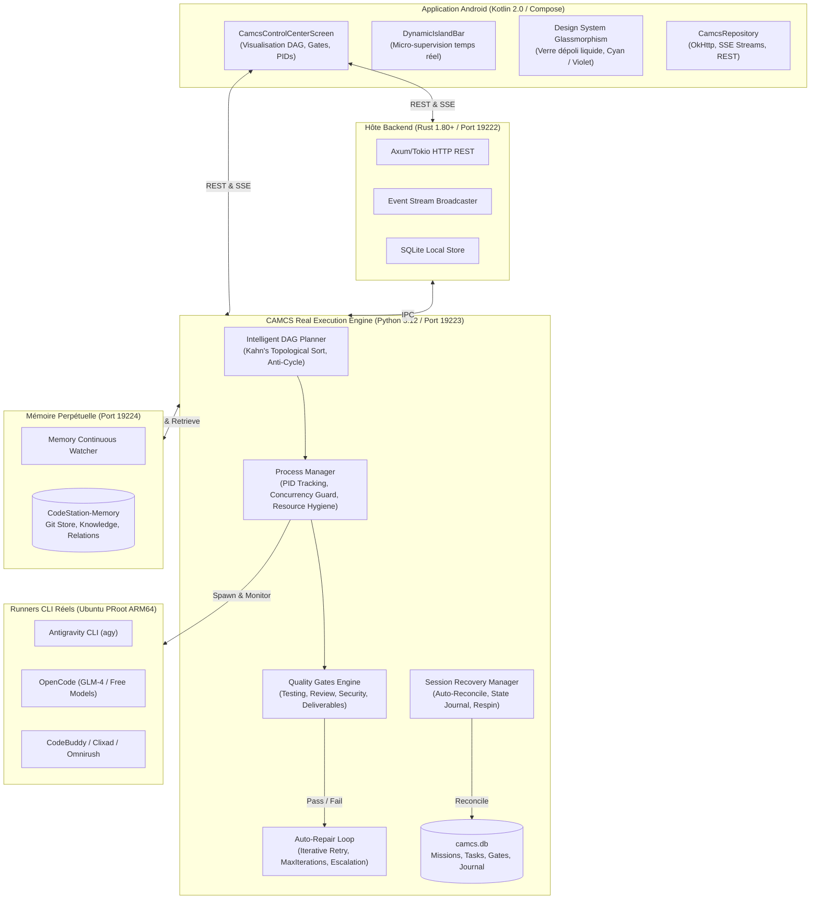

# TARGET ARCHITECTURE — ARCHITECTURE CIBLE CODESTATION ENRICHIE

> **Objectif** : Spécification architecturale cible de CodeStation après intégration des mécanismes avancés de Festival.  
> **Contraintes architecturales inviolables** :  
> - Android Natif Kotlin 2.0 + Jetpack Compose.  
> - Backend Ubuntu PRoot ARM64 (Linux / Termux).  
> - Utilisation exclusive des CLI réellement détectés (`agy`, `opencode`, `codebuddy`, `clixad`, `freebuff`, `omnirush`).  
> - 100% Modèles Gratuits et Locaux privilégiés, compatibilité OpenAI-compatible sans surcoût.  
> - Préservation intégrale de `CodeStation-Memory` et des données persistantes SQLite.  
> - Préservation absolue du Design System Frosted Liquid Glassmorphism.

---

## 1. Vue d'Ensemble des Composants

L'architecture cible unifie le moteur d'exécution CAMCS, la mémoire perpétuelle et le client Android en une chaîne d'orchestration continue et résiliente :

---

## 2. Responsabilités des Nouveaux Modules et Extensions

### 2.1 Extension du `DagPlanner` (`scripts/camcs/dag_planner.py`)
- **Tri Topologique de Kahn** :
  - Calcule l'ordre strict d'exécution des tâches.
  - Détecte immédiatement les dépendances circulaires (`CycleDetectedException`).
  - Identifie en temps réel les tâches dont toutes les dépendances sont résolues (`in_degree == 0`) pour leur attribution parallèle.
- **Support des Phases et Séquences** :
  - Regroupe les tâches par phases logiques (`Phase`: Discovery, Scaffolding, Core, Verification).
  - Établit des jalons d'approbation entre phases.

### 2.2 Extension du `QualityAuditor` (`scripts/camcs/quality_auditor.py`)
- **Système de Quality Gates Multi-types** :
  - `TESTING` : Exécute une commande de test shell et vérifie le code retour (0 = pass).
  - `SECURITY` : Scanne les modifications pour détecter les secrets, clés API exposées et permissions dangereuses.
  - `DELIVERABLES` : Contrôle physique d'existence, taille non nulle et conformité d'empreinte SHA-256.
  - `REVIEW` : Vérifie les critères d'acceptation et les livrables d'auto-évaluation.
- **Résultat Structuré** : Chaque gate génère un rapport horodaté avec statut (`PASSED`, `FAILED`, `ESCALATED`) et journalisé dans la table `quality_gates`.

### 2.3 Moteur de Réconciliation et Reprise (`SessionRecoveryManager`)
- **Détection des Interruptions** : Au démarrage du démon CAMCS, analyse automatique des missions au statut `RUNNING`.
- **Réconciliation** :
  - Vérification des processus OS résiduels via PID.
  - Contrôle des fichiers générés sur le disque.
  - Si les livrables d'une tâche interrompue sont déjà valides, la tâche est promue à `COMPLETED` ; sinon, elle est réinitialisée à `READY` pour reprise sans perte.
- **Journalisation de Continuité** : Consignation de chaque étape de reprise dans le journal persistant de la mission.

### 2.4 Boucle Auto-Itérative Corrective (`AutoRepairLoop`)
- En cas d'échec d'une tâche ou d'une Quality Gate, le moteur ne marque pas immédiatement la mission comme échouée.
- Il injecte la trace d'erreur précise dans un sous-prompt de correction confié à l'agent responsable.
- **Limite Stricte** : `max_iterations = 3`.
- Si l'erreur persiste au 3ème essai, la tâche bascule en `NEEDS_APPROVAL` avec notification immédiate à l'opérateur humain via l'écran d'approbation.

### 2.5 Extension de l'Interface Android (`CamcsControlCenterScreen.kt`)
- Intégration d'un volet d'inspection des **Quality Gates** et de l'état du graphe topologique DAG.
- Utilisation exclusive des composants existants : `Modifier.frostedLiquidGlass()`, `Capsule()`, `Palette.electricBlue`, `Palette.neonGreen`, `Palette.danger`.
