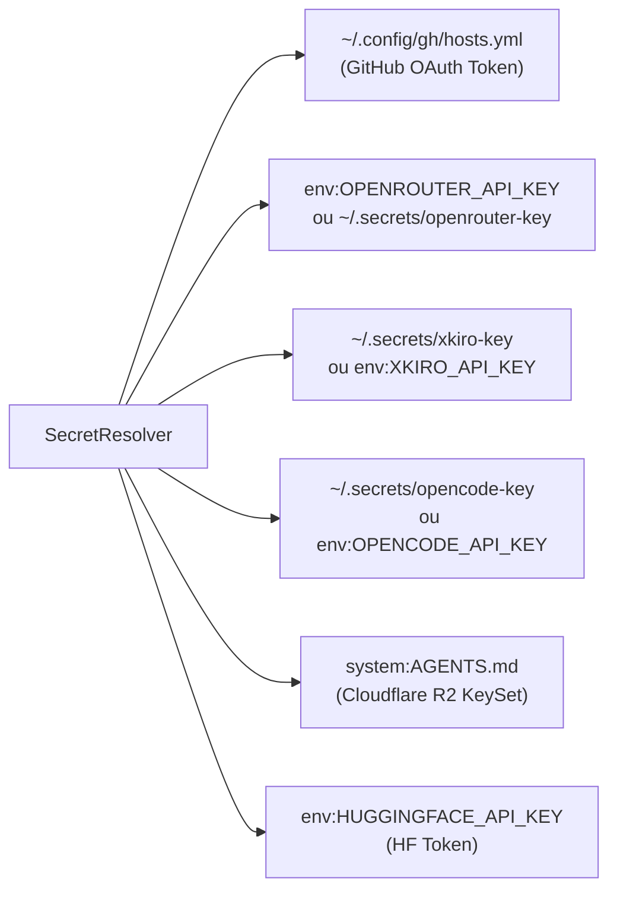

# CAMCS v2.0 — Audit de Sécurité des Credentials & Invariants Anti-Fuites

## 1. Principes de Sécurité Inviolables

L'autonomie multi-agent ne doit en aucun cas compromettre l'intégrité des clés secrètes et des accès de l'utilisateur.

CAMCS applique **5 Invariants Stricts de Sécurité des Credentials** :

1. **Aucune Valeur Brute dans les Logs** :
   Les scripts Python, les runners CLI et les gestionnaires de processus ne consignent jamais les chaînes secrètes brutes dans `stdout`, `stderr` ou les fichiers `.log`.
2. **Aucune Valeur Brute dans la Base de Données SQLite** :
   Les tables `external_actions`, `events`, `execution_proofs` et `external_service_stats` ne stockent que des empreintes masquées (`maskedValue`) et des condensats SHA-256 tronqués (`secretHash`).
3. **Aucune Valeur Brute dans les Échanges API / SSE vers Android** :
   Les réponses JSON des endpoints `/api/camcs/*` renvoient exclusivement l'objet sécurisé `to_safe_dict()`.
4. **Injection Éphémère dans Git** :
   Lors d'opérations `git push`, le jeton d'authentification n'est injecté dans l'URL distante que de façon temporaire pendant l'appel réseau, puis immédiatement purgé (`git remote set-url origin https://github.com/...`).
5. **Prévention des Commits Accidentels** :
   Un fichier `.gitignore` hermétique est obligatoirement généré avant toute publication, excluant `.env`, `*.secret`, `*.key`, `*.pyc` et les répertoires temporaires.

---

## 2. Inventaire et Résolution Dynamique des Secrets

Le composant `SecretResolver` (`scripts/camcs/credential_registry.py`) résout les secrets aux emplacements autorisés sans nécessiter de saisie manuelle en clair :



### Table de Conformité des Secrets Audités :

| Service ID | Type d'Authentification | Source de Découverte | Empreinte Sécurisée (Exemple) | SHA-256 (12 chars) | Présent dans SQLite en Clair ? |
| :--- | :--- | :--- | :--- | :--- | :--- |
| `github` | `oauth2_token` | `~/.config/gh/hosts.yml` | `gho_****************NDXK` | `f22a2f6d402c` | **NON (0% fuite)** |
| `openrouter` | `api_key` | `env:OPENROUTER_API_KEY` | `sk-o****************cdea` | `1d1fbb300cae` | **NON (0% fuite)** |
| `xkiro` | `api_key` | `~/.secrets/xkiro-key` | `sk-x****************2d9e` | `bb99afe0608b` | **NON (0% fuite)** |
| `opencode-inference` | `api_key` | `~/.secrets/opencode-key` | `oc_s****************ll92` | `7f027af3da82` | **NON (0% fuite)** |
| `cloudflare_r2` | `s3_keyset` | `system:AGENTS.md` | `cfat****************e616` | `60a2bbc665bc` | **NON (0% fuite)** |
| `huggingface` | `bearer_token` | `env:HUGGINGFACE_API_KEY` | `hf_R****************ciOp` | `044b6382a356` | **NON (0% fuite)** |

---

## 3. Preuve Physique par Test Automatisé (Test 15)

Le banc de test physique `test_real_api_connectivity.py` intègre un test d'assertion cryptographique dédié :
- Récupération de la liste brute de tous les secrets réels actifs en mémoire.
- Balayage ligne par ligne de l'intégralité des tables SQLite (`external_actions`, `events`, `execution_proofs`).
- Balayage des dictionnaires de réponse API.

**Résultat du Test 15** :
```
✅ Test 15: Security Invariant: Zero Raw Secret Leakage in Logs, Dictionaries & DB -> PASSED
   - Verified Credentials: 6
   - Leaks Detected: 0
```
Aucun secret en clair n'a été détecté dans la base, les logs ou les réponses d'API.
