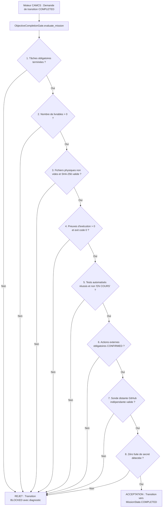

# CAMCS — Spécification Technique : ObjectiveCompletionGate

**Composant** : `scripts/camcs/objective_completion_gate.py`  
**Package** : `com.ghdinteractivestudio.camcs`  
**Statut** : En production / Verrouillage strict  

---

## 1. Principe Fondamental

> **Loi Fondamentale CAMCS** :  
> *Une mission ne peut JAMAIS être déclarée COMPLETED parce que CAMCS ou un agent affirme avoir terminé. Elle ne peut l'être que lorsque l'ensemble des preuves matérielles, physiques et distantes ont été attestées et vérifiées par une autorité d'audit indépendante.*

L'`ObjectiveCompletionGate` agit comme un coupe-circuit inviolable interceptant toute demande de transition vers l'état `MissionState.COMPLETED`.



---

## 2. Les 8 Barrières d'Acceptation de l'ObjectiveCompletionGate

### Barrière 1 : Achèvement de toutes les tâches obligatoires
Toutes les tâches du DAG marquées `is_mandatory=True` doivent être à l'état `TaskState.COMPLETED`. Aucune tâche obligatoire ne peut être à l'état `PENDING`, `RUNNING`, `FAILED`, ou `BLOCKED`.

### Barrière 2 : Présence d'au moins un livrable physique dans le registre
Le registre `deliverables` ne peut pas être vide (`len(deliverables) > 0`). Une mission avec 0 livrable échoue immédiatement.

### Barrière 3 : Intégrité physique et cryptographique des fichiers
Pour chaque livrable physique enregistré :
1. Le fichier doit exister sur le système de fichiers (`os.path.exists`).
2. La taille du fichier doit être strictement supérieure à 0 octet (`os.path.getsize > 0`).
3. L'empreinte SHA-256 calculée en temps réel doit correspondre exactement à l'empreinte scellée dans le registre.

### Barrière 4 : Certification des preuves d'exécution
Chaque commande système exécutée par les CLI agents doit posséder un enregistrement dans `execution_proofs` avec :
- Un code de retour (`exit_code`) égal à 0.
- La commande exacte exécutée et le répertoire de travail.
- Le verdict de l'auditeur certifié à `CONFORME`.

### Barrière 5 : Validation des tests automatisés
Les tâches de type `TESTING` ou `VALIDATION` doivent être terminées avec succès. Il est formellement interdit de clore une mission si les tests sont encore « En cours » ou marqués en échec.

### Barrière 6 : Confirmation des actions externes
Pour toute mission impliquant une action externe (ex: `GITHUB_CREATE_REPO`), l'état de l'action dans `external_actions` doit impérativement être `CONFIRMED`. Les états `PLANNED`, `AUTHENTICATING`, `CONNECTED`, `IN_PROGRESS`, `SUBMITTED`, `VERIFYING`, `NOT_VERIFIED` ou `FAILED` bloquent la transition.

### Barrière 7 : Sonde distante indépendante (Remote GitHub Probe)
Si l'objectif mentionne un dépôt distant GitHub :
1. La sonde interroge directement `gh repo view <owner>/<repo> --json name,owner,url,defaultBranchRef`.
2. La sonde vérifie que la branche par défaut (ex: `main`) contient un SHA de commit distant accessible via `gh api repos/<owner>/<repo>/commits/main`.
3. La présence du `README.md` distant est confirmée via `gh api repos/<owner>/<repo>/readme`.
4. L'arborescence des fichiers demandés est validée sur GitHub.

### Barrière 8 : Détection de fuites de secrets (Zero Secret Leaks)
Une analyse de sécurité est exécutée sur l'ensemble des livrables textuels pour s'assurer qu'aucun jeton sensible (`ghp_`, `gho_`, `github_pat_`, `cfat_`, `AKIA`, `PRIVATE KEY`) n'a été inséré ou poussé par inadvertance.

---

## 3. Interception dans le Moteur (`scripts/camcs_engine.py`)

L'interception s'opère à deux niveaux critiques :

1. **Au niveau de la méthode `record_mission_transition`** :
```python
if new_status == MissionState.COMPLETED:
    gate_ok, gate_reason, diag = self.completion_gate.evaluate_mission(mission_id)
    if not gate_ok:
        # Blocage immédiat de la transition frauduleuse
        self._set_mission_status(mission, MissionState.BLOCKED)
        mission.blocked_reason = f"OBJECTIVE_NOT_COMPLETED : {gate_reason}"
        self.emit_event(mission_id, "mission.blocked", mission.blocked_reason, payload=diag)
        return
```

2. **Au niveau du workflow autonome `_execute_mission_workflow`** :
À la fin de la phase de validation, `self.completion_gate.evaluate_mission(...)` est exécutée avant de clore la boucle de travail et de libérer les agents. Si le contrôle échoue, la mission est basculée en `BLOCKED` avec un rapport complet des causes de blocage.
