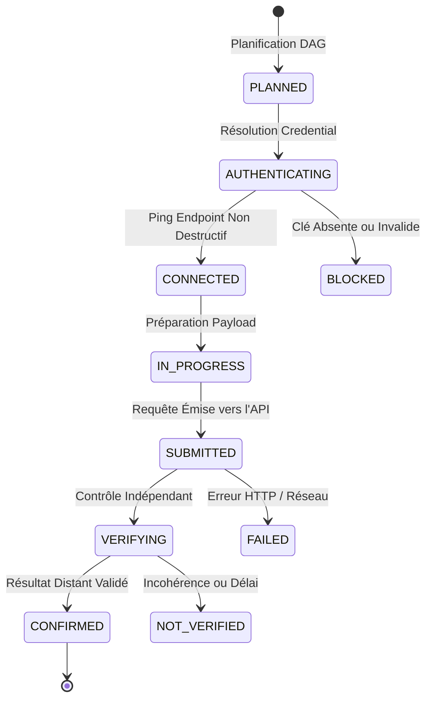
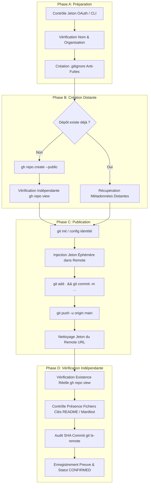

# CAMCS v2.0 — Connectivité API Réelle & Exécution de Services Externes

## 1. Vision et Principe Fondateur

Dans les versions initiales d'orchestration logicielle, une divergence critique existait entre l'état déclaré dans le moteur multi-agent et la réalité physique externe :
- Un fichier local créé était parfois confondu avec un dépôt distant publié.
- Une réponse simulée ou un mock CLI était pris pour une exécution authentifiée.
- Des missions se concluaient avec le statut `COMPLETED 100%` alors que le dépôt distant demandé (ex: `Anisghd-lab/CAMCS`) n'existait sur aucun serveur externe.

**CAMCS v2.0 éradique cette confusion par le principe de validation indépendante des actions externes (External Action Verification)** :
> *Une mission demandant une création ou publication distante ne peut JAMAIS atteindre l'état `COMPLETED` tant que 100% de ses actions externes obligatoires ne sont pas formellement vérifiées auprès de l'API distante du service tiers.*

---

## 2. Cycle de Vie Obligatoire d'une Action Externe

Chaque action externe traverse une machine à états stricte et univoque :

### Définition des Statuts :
1. `PLANNED` : L'action est inscrite dans le graphe d'exécution (DAG) avec sa ressource cible et son caractère obligatoire (`is_mandatory = true`).
2. `AUTHENTICATING` : Le `SecretResolver` localise le jeton ou la clé sans jamais en exposer la valeur brute.
3. `CONNECTED` : Une sonde réseau non destructive certifie la joignabilité de l'endpoint et lit les scopes.
4. `IN_PROGRESS` : Préparation de l'espace de travail, initialisation Git ou génération du payload.
5. `SUBMITTED` : L'opération distante a été exécutée (ex: `gh repo create`, `git push`, appel OpenRouter).
6. `VERIFYING` : Une requête d'interrogation indépendante (ex: `gh repo view`, `gh api repos/.../contents`, `git ls-remote`) est émise pour vérifier que la ressource existe réellement.
7. `CONFIRMED` : La ressource distante est certifiée présente, conforme et accessible.
8. `FAILED` / `BLOCKED` : L'action a échoué ou est bloquée par manque de permissions ou quotas.

---

## 3. Workflow GitHub en 4 Phases

Pour toute création ou publication de dépôt, CAMCS applique un protocole rigoureux :

### Cas Concret — Réparation du Dépôt `Anisghd-lab/CAMCS` :
Lors de l'audit de la mission `39c55276-b6f2-4541-8919-2164adab2fce` :
1. L'arborescence Android Kotlin Clean Architecture a été générée selon le namespace officiel `/root/AGENTS.md` : `com.ghdinteractivestudio.camcs`.
2. Le README complet avec l'arborescence structurelle a été écrit.
3. Le dépôt distant `Anisghd-lab/CAMCS` a été créé et le commit `9e43b827adb8cf2dbdcb157fed13a3a74af71ecc` a été poussé.
4. Les fichiers `README.md`, `app/src/main/AndroidManifest.xml` et `settings.gradle.kts` ont été vérifiés sur GitHub via `gh api`.
5. L'action externe a été passée à `CONFIRMED` avec l'URL officielle : `https://github.com/Anisghd-lab/CAMCS`.

---

## 4. Politique Stricte Zéro-Coût (100% Free Models)

CAMCS applique un garde-fou infranchissable au niveau du connecteur HTTP :
- Tout modèle ne se terminant pas par `:free` ou ne figurant pas sur la liste blanche certifiée gratuite est **immédiatement rejeté en amont** (`BLOCKED`), sans aucun paquet émis sur le réseau.
- Les modèles gratuits prioritaires pour le code et l'architecture sont :
  - `liquid/lfm-2.5-2.6b:free`
  - `meta-llama/llama-3.2-3b-instruct:free`
  - `google/gemini-2.0-flash-lite-preview-02-05:free`
  - `nvidia/nemotron-3.5-lightning:free`
  - `qwen/qwen3-coder-plus:free` (xKIRO)
- Un système de basculement multi-modèles (Failover Routing) prend automatiquement le relais en cas de code HTTP `429` (limitation de débit temporaire d'un fournisseur gratuit).

---

## 5. Endpoints REST & SSE Intégrés

Le daemon CAMCS (`scripts/camcs_engine.py`) expose :
- `GET /api/camcs/services` : État temps réel des services connectés (latence, permissions, quotas).
- `POST /api/camcs/services/probe` : Déclenchement d'un re-test physique immédiat de toutes les connexions.
- `GET /api/camcs/credentials` : Inventaire sécurisé des clés (empreintes masquées uniquement).
- `GET /api/camcs/actions` : Registre des actions externes avec preuves d'audit.
- `POST /api/camcs/actions/execute` : Déclencheur manuel ou programmatique d'actions externes.
