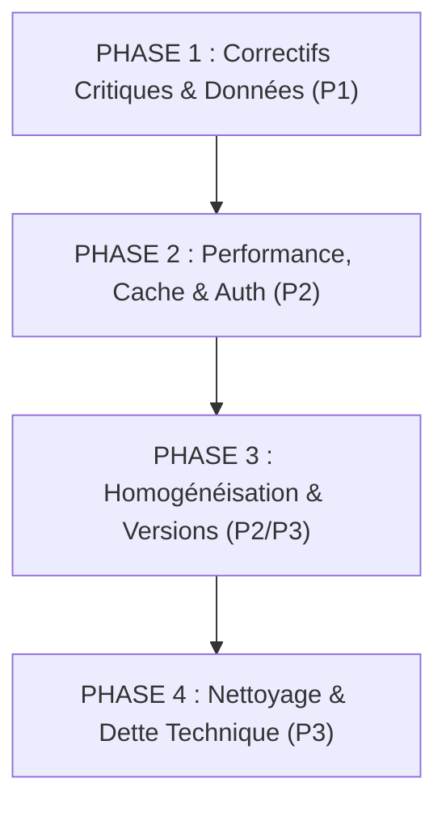

# CODESTATION — PLAN DE REMÉDIATION PRIORISÉ & ROADMAP
**Ordonnancement des corrections en fonction des dépendances techniques**

- **Document associé** : `CODESTATION_GLOBAL_AUDIT_REPORT.md`  
- **Objectif** : Traiter méthodiquement l'ensemble des anomalies identifiées lors de l'audit sans risquer de régression sur le système opérationnel.  
- **Règle absolue** : Attendre la validation explicite de l'utilisateur avant d'engager les modifications.  

---

## 1. Vue d'Ensemble des Phases de Remédiation

---

## 2. Détail des Actions par Phase

### Phase 1 : Fiabilisation des Données & Synchronisation (Priorité P1)
*Dépendances : Aucune. Impact direct sur la précision des informations affichées à l'utilisateur.*

1. **[P1-01] Correction du calcul des bots actifs dans `ServerRepositoryImpl.kt`** :
   - *Fichier* : `app/src/main/kotlin/com/ghdinteractivestudio/codestation/data/local/ServerRepositoryImpl.kt`
   - *Problème* : Ligne 161 lit `hello.backends?.size` au lieu du nombre de bots réels.
   - *Correction* : Récupérer le compte réel des bots via `botDao.getAllBots().size` ou enrichir `/api/hello` pour retourner `activeBotsCount: hub.store.bots_count()`.
   - *Risque de régression* : Nul.

2. **[P1-02] Amorçage automatique (Seed) du Roster local Android** :
   - *Fichier* : `app/src/main/kotlin/com/ghdinteractivestudio/codestation/data/local/BotRepositoryImpl.kt`
   - *Problème* : Si l'utilisateur démarre l'application sans flux SSE actif, le Roster Room ne reflète pas les 7 bots existants dans `codync.db`.
   - *Correction* : Ajouter un import automatique des bots de `codync.db` lors de la première initialisation de `CodeStationDatabase` ou au premier handshake `hello`.
   - *Risque de régression* : Très faible si géré par `insertOrIgnore` (conflit IGNORE).

---

### Phase 2 : Optimisation des Performances & Connectivité (Priorité P2)
*Dépendances : Phase 1 terminée.*

3. **[P2-03] Mise en cache TTL des statuts Providers dans `camcs_engine.py`** :
   - *Fichier* : `scripts/camcs_engine.py`
   - *Problème* : L'appel `/api/camcs/providers` effectue des tests de latence réseau en direct pouvant monter à 1.48s.
   - *Correction* : Implémenter un cache mémoire TTL de 20 secondes sur `get_providers_status()`.
   - *Risque de régression* : Nul.

4. **[P2-02] Diagnostic et assistance à l'authentification Codex** :
   - *Fichier* : `host/src/agent/backends.rs` & `RosterScreen.kt`
   - *Problème* : Codex est installé mais `signedIn: false`.
   - *Correction* : Afficher un badge explicite "Authentification requise" sur le bot Codex avec action pour lancer `codex login --device-auth` dans Termux.
   - *Risque de régression* : Nul.

5. **[P2-04] Robustesse du streaming SSE sous mauvaise couverture réseau** :
   - *Fichier* : `CodeStationEventStreamClient.kt`
   - *Correction* : Intégrer un buffer de replay local persistant pour reprendre exactement au dernier `lastRev` sans trou d'événement lors d'un basculement Wi-Fi <-> 4G/5G.
   - *Risque de régression* : Faible.

---

### Phase 3 : Harmonisation des Versions & CI/CD (Priorité P2 / P3)
*Dépendances : Phases 1 et 2 validées.*

6. **[P2-01] Harmonisation des versions applicatives** :
   - *Fichiers* : `app/build.gradle.kts`, `host/Cargo.toml`, `scripts/camcs_engine.py`
   - *Action* : Aligner la version globale du produit sur **v1.0.7** (ou **v1.1.0** après intégration de CAMCS v2.28 et Continuous Memory v1.0).
   - *Tag Git* : Poser le tag officiel correspondant sur le dépôt principal.
   - *Risque de régression* : Nul.

---

### Phase 4 : Nettoyage de la Dette Technique & Tests UI (Priorité P3)
*Dépendances : Phases 1 à 3 terminées.*

7. **[P3-01] Remplacement progressif du nommage legacy (`codync` / `synapse`)** :
   - *Fichiers* : `host/src/main.rs`, documentation, scripts.
   - *Action* : Prévoir une migration transparente de `codync.db` vers `codestation.db` tout en maintenant un lien symbolique pour la rétrocompatibilité des anciens scripts.
   - *Risque de régression* : Moyen (doit être testé sur une copie de sauvegarde).

8. **[P3-02] Suite de tests d'intégration Compose sur appareil réel** :
   - *Fichier* : `app/src/androidTest/`
   - *Action* : Ajouter des tests instrumentés automatisés pour valider le clic sur l'icône Historique du Roster et la navigation dans les onglets CAMCS.
   - *Risque de régression* : Nul.

---

## 3. Matrice de Décision et Prochaines Étapes

| Étape | Description | Estimation | Prérequis |
| :--- | :--- | :--- | :--- |
| **Étape A** | Correction du bug `activeBots` (`ServerRepositoryImpl.kt`) | ~10 min | Accord utilisateur |
| **Étape B** | Cache TTL 20s sur les providers CAMCS (`camcs_engine.py`) | ~10 min | Accord utilisateur |
| **Étape C** | Amorçage initial du Roster depuis le Host | ~25 min | Accord utilisateur |
| **Étape D** | Harmonisation des versions vers v1.1.0 | ~15 min | Validation Étapes A-C |
