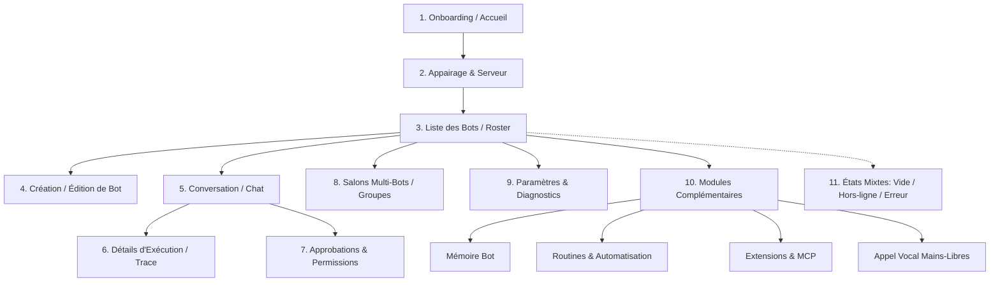

# SCREEN_INVENTORY.md — Inventaire Exhaustif des Écrans & Flux UI

> **Application** : Synapse (`com.ghdinteractivestudio.synapse`)  
> **Framework** : Android Natif (Kotlin 2.0 + Jetpack Compose + Material 3)  
> **Date de rédaction** : 27 Octobre 2026

---

## Vue d'Ensemble des 11 Parcours Fonctionnels

L'application Synapse structure l'expérience utilisateur autour d'une navigation fluide par pile (Navigation Compose), articulée autour du panneau principal de gestion des agents et de leurs conversations.

---

## 1. Onboarding & Présentation
* **Rôle** : Premier contact avec l'application lors d'un lancement sans serveur configuré.
* **Composants Clés** :
  - `SynapseHeroBanner` : Animation vectorielle du noyau Synapse et logo original.
  - `FeatureSlide` : Carousel présentant :
    1. *Multi-Agent Ecosystem* (Pilotez Claude Code, Codex, Gemini et vos agents locaux).
    2. *Local-First & E2E Secure* (Liaison directe Termux/PRoot 127.0.0.1 ou serveur dédié).
    3. *Autonomous Tool Orchestration* (Approbations interactives et traces d'exécution en temps réel).
  - Boutons d'action : « Configurer mon serveur » (redirige vers l'écran d'appairage) et « Découvrir le mode démo ».
* **États** : Lancement initial, Transition entre diapositives.

---

## 2. Configuration du Serveur & Appairage
* **Rôle** : Établir la connexion avec l'hôte local Termux/PRoot (`127.0.0.1:19222` ou personnalisé) ou un serveur distant.
* **Composants Clés** :
  - `ServerModeSelector` : Sélecteur segmented (Boucle Locale Termux / Hôte Réseau LAN / Serveur Cloud Distant).
  - `ServerUrlInput` : Champ texte avec validation en temps réel du format d'URL (`http://`, `https://`, `ws://`).
  - `TokenPairingField` : Champ de saisie ou collage de jeton cryptographique (`synapse://pair?token=...`).
  - `TestConnectionButton` : Bouton de vérification active avec sonde ping.
  - `ConnectionStatusCard` : Carte dynamique affichant l'état en direct :
    - *En attente* : neutre.
    - *Test en cours* : indicateur rotatif avec décompte de grâce.
    - *Connecté* : badge vert avec version du serveur, latence (ms) et identifiant hôte.
    - *Erreur* : message explicatif clair avec bouton de réessai.
* **Interactions** : Sonde réseau, persistance des identifiants dans `DataStore`, redirection automatique vers la liste des bots dès la validation.

---

## 3. Liste des Bots (Roster Principal)
* **Rôle** : Tableau de bord central listant tous les agents configurés, leur activité et l'accès direct aux conversations.
* **Composants Clés** :
  - `RosterHeader` :
    - Titre dynamique avec badge de connexion serveur (`Connecté`, `Hors-ligne`, `Reconnexion...`).
    - Bouton filtre / recherche par nom ou statut.
    - Bouton d'action flottant (+) : Nouveau Bot ou Nouveau Groupe.
  - `LeadBotCard` :
    - Carte mise en valeur avec bordure accentuée et badge étoile dorée `★`.
    - Présente l'agent principal responsable des check-ins proactifs et des synthèses.
  - `BotSection` (Épinglés & Récents) :
    - `BotCard` :
      - `BotAvatar` : Avatar vectoriel avec indicateur d'état pulsant (Repos, En cours de réflexion, Occupé, Hors-ligne).
      - Nom du bot et tag du fournisseur d'IA (Claude Code, OpenAI Codex, Gemini CLI, OpenCode, Rust ACP).
      - Extrait du dernier message et horodatage relatif.
      - Pastille de messages non lus (`UnreadBadge`) et badge d'approbations en attente.
* **Interactions** : Clic pour ouvrir la conversation, appui long pour actions contextuelles (Épingler, Modifier, Arrêter le bot, Supprimer), pull-to-refresh pour resynchroniser avec le backend.

---

## 4. Création & Modification d'un Bot (Bot Editor)
* **Rôle** : Personnaliser l'identité, le modèle et les privilèges d'un agent.
* **Composants Clés** :
  - `AvatarCustomizer` : Sélecteur de forme de glyphe (Cercle, Polygone, Onde, Étoile) et sélecteur de teinte d'accent.
  - `BotIdentityFields` : Nom de l'agent, Rôle / Description courte.
  - `ProviderSelector` : Choix du moteur (Claude Code, OpenAI, Google Gemini, OpenCode, ACP Local).
  - `ModelSelector` : Choix du modèle (`claude-3-7-sonnet`, `gpt-4o`, `gemini-2.0-flash`, etc.) avec interrupteur *Fast Mode*.
  - `WorkspaceSelector` : Espace isolé personnel (*Personal Sandbox*) ou Répertoire de projet spécifique (`/root/...`).
  - `InstructionEditor` : Éditeur de consignes système (*System Prompt*) avec compteur de caractères et modèles types.
  - `PermissionPolicySelector` : Politique d'approbation (Autonome, Demander pour les commandes bash, Demander pour l'écriture de fichiers, Lecture seule).
* **Interactions** : Validation des champs obligatoires, sauvegarde instantanée ou bouton « Enregistrer », dialogue de confirmation lors de la suppression.

---

## 5. Conversation (Thread / Chat)
* **Rôle** : Écran principal d'échange bidirectionnel avec un agent ou un groupe.
* **Composants Clés** :
  - `ChatHeader` :
    - Bouton retour.
    - Avatar du bot avec état en direct.
    - Titre du bot avec sous-titre de statut (`Inactif`, `Écrit une réponse...`, `Exécute bash (12s)`).
    - Bouton d'accès aux détails de l'agent.
  - `ConversationList` :
    - `UserMessageBubble` : Bulle utilisateur alignée à droite avec citation de réponse éventuelle (`QuotedReplyView`).
    - `AgentMessageBubble` : Bulle agent alignée à gauche avec rendu Markdown natif, blocs de code avec coloration syntaxique et bouton copie.
    - `WorkingStatusPill` : Pilule d'activité animée avec orbe oscillant, libellé de l'action en cours et chronomètre écoulé.
    - `ArtifactCard` : Carte interactive prévisualisant un rapport ou tableau HTML généré par l'agent.
    - `BotExchangeRow` : Ligne discrète matérialisant les échanges inter-bots (« A envoyé un message à Owen »).
  - `ReplyBar` : Barre rétractable affichant l'extrait du message auquel l'utilisateur répond, avec bouton de fermeture (✕).
  - `MessageComposer` :
    - Champ texte multi-lignes extensible.
    - Bouton de pièce jointe (fichiers, images, snippets).
    - Bouton d'action dynamique :
      - *Microphone / Waveform* quand le texte est vide (déclenche la dictée vocale ou l'appel).
      - *Flèche d'envoi* dès qu'un caractère ou un fichier est présent.
      - *Bouton Stop* si le bot est en train de travailler pour interrompre le tour.
* **Interactions** : Défilement automatique vers le bas, bouton flottant « Revenir au dernier message », glisser pour répondre.

---

## 6. Détails d'Exécution & Événements (Turn Trace)
* **Rôle** : Transparence totale sur la chaîne de raisonnement et les actions exécutées par l'IA.
* **Composants Clés** :
  - `ExecutionStepCard` :
    - Étape de pensée (*Thought process* avec extrait dépliable).
    - Appel d'outil (*Tool call* : nom de l'outil, paramètres JSON formatés, durée d'exécution).
    - Résultat de l'outil (*Output* : code de sortie, logs ou diff de fichiers modifiés).
  - `RawEventStreamViewer` : Journal brut des événements JSON reçus du backend pour le débogage technique.
* **Interactions** : Dépliage/repliage des étapes, copie des commandes dans le presse-papier.

---

## 7. Cartes d'Approbation & Permissions
* **Rôle** : Garantir la sécurité lors de l'exécution de commandes système ou d'accès sensibles.
* **Composants Clés** :
  - `ApprovalCard` :
    - En-tête d'avertissement avec type d'action (Commande Shell, Modification de Fichier, Appel Réseau).
    - Corps : aperçu complet de la commande ou du patch de fichier.
    - Boutons d'action clairs :
      - *Approuver une fois* (vert).
      - *Toujours approuver pour cette session*.
      - *Refuser / Annuler* (rouge).
  - Gestion des états : En attente, En cours de soumission (spinner sur l'option choisie), Confirmé (grisé avec mention du choix validé).
* **Interactions** : Émission immédiate de la décision vers le repository / backend, déblocage du tour de travail de l'agent.

---

## 8. Salons Multi-Bots (Group Chats)
* **Rôle** : Collaboration entre plusieurs bots et l'utilisateur dans une conversation commune.
* **Composants Clés** :
  - `GroupCreationDialog` : Saisie du nom du groupe, de sa mission, et sélection par cases à cocher des bots participants.
  - `GroupAvatarStack` : Superposition élégante des avatars des membres du groupe.
  - Rendu des messages de groupe avec étiquette d'auteur au-dessus de chaque bulle (`Alice`, `Bob`, `User`).
  - Gestion des mentions `@nom_du_bot` pour solliciter un participant précis.
* **Interactions** : Orchestration des tours de parole gérée par le backend ou le coordinateur local.

---

## 9. Paramètres, Préférences & Diagnostic
* **Rôle** : Configuration globale de l'application et outils de diagnostic.
* **Composants Clés** :
  - `SettingsGroup` :
    - *Apparence* : Thème Thématique (Système, Sombre Obsidian, Clair Platine).
    - *Expérience de Chat* : Activer les détails de réflexion par défaut, taille de police, retour haptique.
    - *Serveur & Réseau* : Adresse actuelle, protocole, délai d'expiration, statut de la connexion.
    - *Sécurité* : Gestion des autorisations accordées aux bots, réinitialisation des clés de session locales.
    - *Diagnostics* : Visualiseur des journaux internes de l'application, bouton d'export du diagnostic.
    - *À propos* : Identité Synapse v1.0.0, licences open-source, informations de build.
* **Interactions** : Sauvegarde synchrone via `DataStore`, mise à jour immédiate du thème sans redémarrage.

---

## 10. Pages Complémentaires (Mémoire, Routines, Extensions, Voix)
* **Rôle** : Modules avancés inspirés de l'écosystème d'agents, avec gestion honnête de la disponibilité.
* **Composants Clés** :
  - `MemoryView` : Explorateur des faits retenus (`MEMORY.md` et fiches thématiques), avec badge indiquant si le bot supporte la mémoire à long terme.
  - `RoutinesView` : Liste des planifications actives (ex: *Check-in quotidien 09h00*), bouton de déclenchement manuel pour test, et formulaire de création de routine.
  - `ExtensionsCatalogView` : Catalogue des connecteurs d'outils (MCP, GitHub, Terminal, Navigateur), avec étiquettes explicites (*Actif*, *Non configuré*, *Non disponible sur hôte local*).
  - `VoiceOverlayView` : Capsule flottante d'appel mains-libres avec reconnaissance vocale et synthèse vocale Android.
* **Règle d'or** : Si une fonctionnalité nécessite un service tiers absent ou indisponible, une vue `FeatureUnavailableCard` explique sobrement la raison et l'alternative sans bloquer l'application.

---

## 11. États Mixtes & Cas Limites (Empty, Offline, Error, Loading)
* **Composants Clés** :
  - `EmptyStateView` : Graphisme vectoriel et message incitatif personnalisé par contexte (ex: « Aucun bot actif — Créez votre premier assistant »).
  - `OfflineBanner` : Bandeau discret signalant la rupture de liaison avec bouton de reconnexion instantanée.
  - `ErrorStateCard` : Affichage d'erreur technique lisible avec code d'erreur et bouton d'action corrective.
  - `LoadingIndicatorView` : Indicateur fluide adapté au thème sombre/clair.
  - `PermissionDeniedView` : Écran pédagogique expliquant la nécessité d'une permission (microphone, notifications) avec bouton vers les paramètres système.
