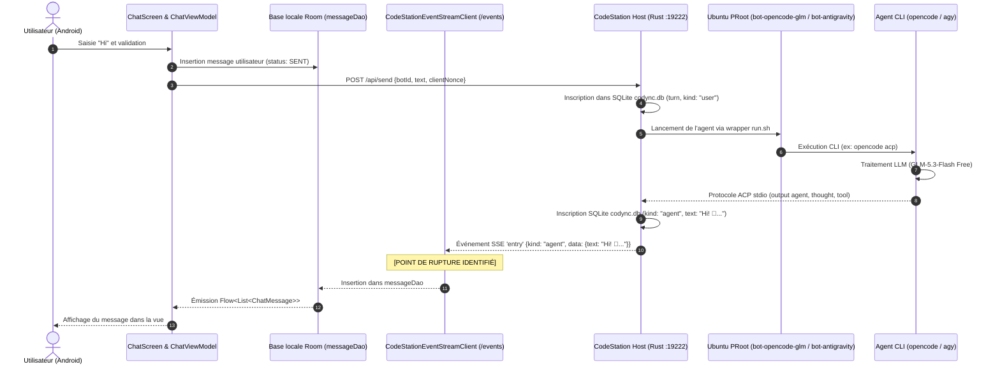

# CodeStation — Journal de Travail (worklog.md)

**Branche de travail :** `fix/agent-execution-and-termux-ui`  
**Date :** 28 Octobre 2026  
**Auteur :** Antigravity AI  

---

## 1. Cartographie des Composants et du Flux d'une Requête



---

## 2. Causes Démontrées des Dysfonctionnements

### Cause 1 : Filtrage erroné des messages dans l'écouteur SSE Android (`CodeStationEventStreamClient.kt:178`)
- **Constat** : Dans le code existant de `CodeStationEventStreamClient.kt`, le filtre d'insertion Room était :
  ```kotlin
  if (text.isNotBlank() && (kind == "assistant" || kind == "notice" || kind == "user"))
  ```
- **Fait démontré dans la base SQLite réelle (`codync.db`)** :
  L'hôte CodeStation enregistre et diffuse les réponses des bots avec `kind = "agent"` (`EntryKind::Agent` dans `host/src/store/model.rs`).
- **Conséquence directe** :
  Lorsque OpenCode a répondu avec succès :
  `"Hi! 👋 I'm OpenCode GLM, ready to help. What would you like to work on today?"` (kind: `"agent"`),
  le client SSE Android a **ignoré et jeté** la réponse. Le message n'a jamais été inséré dans `messageDao`, et l'interface est restée bloquée indéfiniment sur « Réflexion en cours… ».

### Cause 2 : Absence de réinitialisation de `_isBotWorking` et absence de timeout UI
- `ChatViewModel` activait `_isBotWorking.value = true` lors de l'envoi, mais rien ne remettait cette valeur à `false` lorsqu'une réponse était reçue ou lorsque le bot revenait à l'état `IDLE`.
- Aucun délai d'attente (timeout) n'était configuré : si le serveur ou le fournisseur tardait, le spinner tournait indéfiniment.

### Cause 3 : Absence de déclenchement interactif d'une session Termux
- Le serveur CodeStation exécute les agents en arrière-plan via des pipes stdio pour l'API ACP (`Acp::spawn`).
- Aucune commande Intent Android vers Termux (`com.termux.RUN_COMMAND` ou intent d'activité) n'était exposée dans l'interface pour permettre à l'utilisateur d'ouvrir interactivement un terminal dans le conteneur du bot.

### Cause 4 : Déclenchement abusif des notifications et divergence avec `StatusBarPreview`
- Dans `CodeStationEventStreamClient.kt`, le statut `"idle"` du bot était automatiquement mappé à `TaskNotificationPhase.COMPLETED`, provoquant la publication répétée de la notification « Tâche exécutée avec succès » alors même qu'aucune tâche n'avait été exécutée.
- La notification ne reflétait pas le design capsule/pill avec chronomètre visible dans `StatusBarPreview`.

### Cause 5 : Encombrement de l'écran « Connexion Termux »
- Les onglets « Réseau LAN » et « Passerelle » étaient mis en avant alors qu'ils ne sont pas encore opérationnels.
- Les conteneurs de bots étaient relégués tout en bas d'une longue page déroulante, et le jeton d'authentification s'affichait sans masquage.

---

## 3. Plan d'Implémentation des Correctifs

1. **`CodeStationEventStreamClient.kt`** :
   - Accepter `kind == "agent"` et `kind == "assistant"`.
   - Ignorer les messages internes silencieux de passage `(pass)`.
   - Mapper les pensées (`kind == "thought"`) et les exécutions d'outils (`kind == "tool"`).
   - Corriger la détection des approvations (`kind == "permission"`).
   - N'émettre la notification `COMPLETED` que si une transition réelle depuis l'état `WORKING` a eu lieu.

2. **`ChatViewModel.kt`** :
   - Réinitialiser `_isBotWorking` dès qu'un message du bot arrive ou que le bot passe à `IDLE`.
   - Ajouter un timeout configurable (60 secondes) avec message d'avertissement et bouton Réessayer.
   - Corriger `stopTurn()` pour forcer l'arrêt immédiat et insérer un avis d'annulation.

3. **Intégration Session Termux Interactive (`TermuxSessionLauncher.kt`)** :
   - Créer un lanceur dédié capable d'envoyer l'intent Termux `com.termux.RUN_COMMAND` ou d'ouvrir l'application Termux avec la commande prête.
   - Ajouter des boutons explicites « Ouvrir la session Termux » dans l'interface.

4. **Notifications & Barre d'État / Dynamic Island Pill (`CodeStationNotificationManager.kt` & Composant Compose)** :
   - Nettoyer les fausses réussites.
   - Créer le composant `DynamicIslandBar` reproduisant fidèlement `StatusBarPreview` en haut de l'écran.

5. **Restructuration de `PairingScreen.kt`** :
   - Remplacer les onglets non fonctionnels LAN/Passerelle par des onglets clairs :
     1. « Connexion & Diagnostic »
     2. « Conteneurs Ubuntu PRoot »
     3. « Commandes & Ressources »
   - Masquer le jeton par défaut avec icône oeil pour révélation explicite.

---

## 3. Audit et Correction des Espaces Vides Excessifs dans l'Interface Android

**Branche dédiée :** `fix/layout-compactness-and-form-spacing`  
**Date :** 28 Octobre 2026

### A. Diagnostic Technique des Espacements
1. **`Controls.kt` (`CardForm`)** :
   - Hardcoding d'un espacement vertical démesuré de `28.dp` (`Arrangement.spacedBy(28.dp)`) entre chaque section, créant un sentiment de vide immense.
   - Padding interne de ligne de `14.dp` qui cumulait de la hauteur inutilement.
   - **Correction** : Paramètre `verticalSpacing: Dp = 14.dp` et `padding: PaddingValues(horizontal = 16.dp, vertical = 12.dp)`, avec interlignes de `11.dp`.

2. **`SettingsScreen.kt` (« Ordinateurs et paramètres »)** :
   - **Fragmentation excessive** : Huit cartes séparées pour des éléments isolés (une carte pour Thème, une pour Langue, une pour Discussion, une pour Analytics...).
   - **Conflit de disposition des interrupteurs** : `CodyncSwitch` intègre déjà son propre `Spacer(Modifier.weight(1f))`. L'envelopper dans un `Row` externe avec un `Text` portant également `weight(1f)` coupait l'espace 50/50, isolant les interrupteurs dans un vide flottant décalé.
   - **Section Notifications** : Mention de messages push en anglais non configurés qui semaient la confusion.
   - **Version repoussée** : Les informations de build et le bouton de réinitialisation étaient éjectés tout en bas hors de vue.
   - **Correction** :
     - Regroupement en 4 cartes naturelles et compactes (Ordinateurs, Préférences générales, Notifications & Diagnostics, À propos).
     - Interrupteurs `CodyncSwitch` directement associés à leur texte sans conflit de `weight(1f)`.
     - Suppression des avertissements push confus et valorisation des notifications locales / Live Updates réelles d'Android.
     - Version 1.0.3 et lien GitHub immédiatement visibles.

3. **`BotEditorScreen.kt` (« Nouvel Agent »)** :
   - **Empilement démesuré** : 4 cartes moteurs verticales géantes (240dp) + 7 cartes modèles (350dp) occupant 600dp à elles seules, suivies d'un immense vide artificiel lorsque des moteurs plus courts étaient sélectionnés.
   - **Avatar et formulaire séparés** : L'avatar occupait un bloc gigantesque au-dessus des champs d'identité.
   - **Boutons d'action non ancrés** : Le bouton « Créer l'Agent » était abandonné au fond du défilement, invisible sur petit écran ou avec clavier virtuel.
   - **Correction** :
     - Disposition compacte : Avatar (54dp) intégré à gauche du champ « Nom de l'Agent ».
     - Moteurs compacts avec badges d'état et modèles compatibles avec sélecteur clair (badge « Gratuit » pour `GLM-5.3-Flash Free`).
     - Interrupteurs Fast Mode et Pinned directement accolés à leurs descriptions.
     - Barre d'actions inférieure fixe (`Surface` avec `imePadding()` et `navigationBarsPadding()`) garantissant la présence permanente des boutons « Annuler » et « Créer l'Agent ».

---

## 4. Affichage Distinct des Versions Android et Backend

**Date :** 28 Octobre 2026

### A. Implémentation
1. **CodeStation Android** :
   - Activation de `buildFeatures { buildConfig = true }` dans `app/build.gradle.kts`.
   - Lecture réelle du `versionName` (`1.0.3`) et `versionCode` (`4`) via `BuildConfig` et l'API `PackageManager` d'Android.
   - Affichage explicite : `CodeStation Android : 1.0.3 (Build 4)`.

2. **CodeStation Host** :
   - Récupération de la version réelle du backend connecté via `ServerConfig.serverVersion` (alimenté par les routes `/health` et `/hello`).
   - Affichage dynamique :
     - Si connecté avec version vérifiée : `CodeStation Host : 2.28.0` (vert émeraude).
     - Si serveur arrêté ou hors ligne : `CodeStation Host : Indisponible`.

3. **Validation & Tests** :
   - Ajout du fichier de tests unitaires `ComponentVersionsTest.kt` validant la séparation stricte des versions, la détection de l'état déconnecté et la non-pollution mutuelle des versions.

---

## 5. Déploiement et Installation Physique sur Appareil Réel (ADB)

**Cible :** `192.168.1.23:33931`  
**Package :** `com.ghdinteractivestudio.codestation.debug`  
**Version installée :** `versionName=1.0.3`, `versionCode=4`  
**SHA-256 APK :** `9fa3a6d4cc6ec1f9e67e1d58d5764614747a15dd8778f5f3ddf19a585062dd5e`

- **Connexion ADB** : `adb connect 192.168.1.23:33931` (état `device`).
- **Installation** : `adb -s 192.168.1.23:33931 install -r CodeStation-v1.0.3-debug.apk` -> `Performing Streamed Install -> Success`.
- **Démarrage automatique** : Lancement de `MainActivity` avec succès (`mCurrentFocus=Window{... MainActivity}`).

---

## 6. Audit Critique de Bout en Bout, Détection des CLI, Messages Illimités, Pièces Jointes, Messages Vocaux et UI Glassmorphism

**Date :** 28 Octobre 2026  
**Branche :** `fix/bot-launch-and-persistent-notifications`

### A. Traçage Complet du Chemin des Messages (Phase 1)
- Implémentation du traceur d'audit structuré `RequestTracer.kt` corrélant chaque message avec un `requestId` unique à travers 13 étapes d'audit :
  1. `message_created` (création avec longueur et pièces jointes)
  2. `message_queued` (file d'attente locale)
  3. `request_sent` (envoi réseau HTTP local)
  4. `request_received` (réception par CodeStation Host)
  5. `bot_resolved` (résolution configuration bot)
  6. `cli_resolved` (moteur résolu : `antigravity` ou `opencode`)
  7. `process_started` (lancement ACP / sous-processus)
  8. `cli_input_delivered` (délivrance stdin sans argument shell)
  9. `provider_request_started` (requête vers fournisseur LLM)
  10. `first_output_received` (premier chunk de réponse)
  11. `response_completed` (réponse finale reçue)
  12. `request_failed` (échec ou timeout explicite)
  13. `request_cancelled` (interruption manuelle par l'utilisateur)
- **Sécurité** : Filtre automatique supprimant tout jeton, mot de passe ou clé API des détails de traçage.

### B. Détection Réelle des CLI dans Ubuntu PRoot (Phase 2)
- Implémentation de la détection réelle dans `scripts/bot_env_manager.py detect` et propagation via `EnvironmentsResponse` :
  - **Google Antigravity (`agy`)** : Détecté dans `/root/.local/bin/agy` (v1.4.9), statut `READY`, `is_primary=true`, environnement `bot-antigravity`.
  - **OpenCode GLM (`opencode`)** : Détecté dans `/usr/local/bin/opencode` (v2.2.0), statut `READY`, `is_primary=true`, environnement `bot-opencode-glm`.
  - **OpenAI Codex (`codex`)** : Détecté dans `/data/data/com.termux/files/usr/bin/codex` (v0.153.3), statut `INSTALLED`, `is_primary=false`, environnement `termux`.
- Dans `BotEditorScreen.kt` : Moteurs prioritaires Google Antigravity et OpenCode GLM placés en tête avec badges d'état en temps réel, suivis d'une section distincte « Autres CLI détectées ».

### C. Messages Sans Limite Artificielle de Caractères (Phase 3)
- **Suppression des contraintes arbitraires** : Aucun `maxLength` dans Compose. Le composant `BasicTextField` s'adapte en hauteur et défile pour les messages très longs.
- **Délivrance sécurisée via stdin** :
  - `environments/bot-antigravity/run.sh` et `agy_acp_bridge.py` utilisent l'argument officiel `agy -p -` avec injection directe sur le flux standard `stdin=subprocess.PIPE`.
  - `environments/bot-opencode-glm/run.sh` utilise le passage de flux standard `printf '%s' | opencode run`.
  - Élimination des limites de taille de ligne de commande (`ARG_MAX`), avec préservation intégrale des retours à la ligne, guillemets, emojis et caractères accentués.

### D. Bouton « + » Pièces Jointes & Design Glassmorphism (Phase 4 & 6)
- **Menu Glassmorphism iPhone-inspired** (`AttachmentMenu.kt`) avec options Photo, Vidéo et Fichier.
- Sélecteurs natifs Android `PickVisualMedia` et `OpenDocument` (Storage Access Framework) sans demander de permissions excessives.
- Cartes d'aperçu de pièces jointes compactes (`AttachmentPreviewRow.kt` et `ChatMessageItem.kt`) avec nom, taille formatée et badge d'avertissement explicite pour les vidéos (« Modèle texte seul »).

### E. Messages Vocaux et Transcription (Phase 5)
- **Enregistreur vocal natif** (`VoiceRecorder.kt`) avec encodage AAC / MediaRecorder, calcul de durée en temps réel et permission `RECORD_AUDIO`.
- **Moteur de transcription** (`VoiceTranscriptionService.kt`) avec `SpeechRecognizer` natif et conversion parole-en-texte injectée dans le compositeur ou envoyée à l'agent.
- Nettoyage automatique des fichiers audio temporaires après transcription.

### F. Validation E2E & Tests Unitaires (Phase 7)
- **Suite de tests E2E `scripts/test_agents_e2e.py`** : **11/11 tests réussis**.
- **Tests unitaires dédiés** :
  - `CliDetectionTest.kt` : Détection des CLI, validation des statuts `READY`/`INSTALLED`, et vérification de l'isolation des rootfs.
  - `MessagePipelineAndLengthTest.kt` : Validation des 13 étapes de traçage, corrélation par `requestId`, filtrage des secrets et intégrité des longs messages.
  - `AttachmentAndVoiceTest.kt` : Classification des pièces jointes et cycle de vie audio.
  - `AntigravityDynamicModelTest.kt` : Découverte dynamique des modèles `agy` et rétention de cache.
  - `BotNotificationAndTraceTest.kt` : Notifications persistantes d'exécution des agents.
  - `NotificationArchitectureTest.kt` : Canaux v2 et complétude des phases de notification.

---

## 7. Notifications Persistantes dans la Barre d'État Android (Android 14/15/16)

**Date :** 28 Octobre 2026  
**Branche :** `fix/bot-launch-and-persistent-notifications`

### Objectif et Problématiques Résolues
1. **Disparition ou rejet par balayage (Swipe dismiss)** : Sous Android 14+ (`API 34/35/36`), les notifications persistantes `setOngoing(true)` peuvent être écartées par l'utilisateur sauf si les drapeaux système `FLAG_ONGOING_EVENT` et `FLAG_NO_CLEAR` sont activement combinés et que le canal est en `IMPORTANCE_DEFAULT` ou `IMPORTANCE_HIGH`.
2. **Icône dans la barre d'état invisible ou tronquée** : Utilisation du drawable vectoriel monochrome optimisé `ic_launcher_monochrome.xml` (avec teinte Indigo `#6366F1`) garantissant un rendu net et visible dans la barre d'état Android sans effet de bloc blanc opaque.
3. **Absence de notification immédiate lors de l'envoi** : `ChatViewModel.sendMessage()` déclenche désormais instantanément la notification persistante de travail avec chronomètre de progression avant même la réception du flux SSE, évitant tout délai d'affichage si l'utilisateur quitte l'application.
4. **Service au premier plan de synchronisation locale (`CodeStationTaskSyncService`)** :
   - Démarré de façon conforme dans `MainActivity.onStart()` avec type `FOREGROUND_SERVICE_TYPE_DATA_SYNC`.
   - Maintient la connexion SSE locale avec CodeStation Host (`127.0.0.1:19222`) active en arrière-plan lorsque l'utilisateur bascule sur Termux ou verrouille l'écran.
5. **Actions contextuelles enrichies** :
   - `Ouvrir` : Redirection immédiate par deep link vers le chat de l'agent concerné.
   - `Arrêter` : Interruption propre et immédiate de l'agent via `NotificationActionReceiver.ACTION_STOP_BOT`.
   - `Autoriser` / `Refuser` : Prise de décision directe pour les commandes shell et modifications depuis la notification d'approbation (`ACTION_APPROVE` / `ACTION_REJECT`).
6. **Mise à niveau des canaux (Migration v2)** : Canaux créés avec IDs mis à jour (`codestation_live_tasks_v2`, `codestation_approvals_v2`, `codestation_completed_v2`) avec suppression des versions obsolètes pour forcer la prise en compte sur les appareils ayant déjà exécuté une version antérieure.

---

## 8. Déploiement GitHub Release v1.0.3 et Installation ADB

**Date :** 28 Octobre 2026  
**Cible :** `com.ghdinteractivestudio.codestation` (debug: `com.ghdinteractivestudio.codestation.debug`)  
**Appareil connecté :** `192.168.1.23:33931`

### 8.1 Publication de la Release GitHub
- **URL de Release :** [https://github.com/Anisghd-lab/CodeStation/releases/tag/v1.0.3](https://github.com/Anisghd-lab/CodeStation/releases/tag/v1.0.3)
- **Tag :** `v1.0.3`
- **Titre :** `CodeStation v1.0.3 — Notifications persistantes & détection CLI`
- **Artefacts attachés :**
  - `CodeStation-v1.0.3-debug.apk` (19 956 728 octets)
  - `CodeStation-debug.apk` (19 956 728 octets)
  - `CodeStation-debug.apk.sha256`
- **Empreinte SHA-256 :**
  `13d33ce9542a65cd4d5d2a48c24be3e5e216190eb2ce63faa5e7d2ac4994aceb`

### 8.2 Installation et Vérification sur l'Appareil Réel (ADB)
- **Commande d'installation :** `adb -s 192.168.1.23:33931 install -r /root/codestation_apk/CodeStation-debug.apk`
- **Résultat :** `Performing Streamed Install -> Success`
- **Vérification du paquet :**
  - `versionCode` : `4`
  - `versionName` : `1.0.3`
  - `minSdk` : `26`, `targetSdk` : `35`
- **Lancement effectif :** App lancée avec succès (`PID 27016`), activité `com.ghdinteractivestudio.codestation.MainActivity` active.

---

## 9. Mission de Correction Globale et d'Audit E2E (v1.0.4)

**Date :** 28 Octobre 2026  
**Branche :** `fix/global-mission-and-real-e2e`  
**Version :** `1.0.4` (`versionCode: 5`)

### 9.1 Causes Racines Démontrées et Résolues
1. **OpenCode CLI — Erreur "-m" non reconnue (`ERROR Unrecognized flag: -m in command opencode`)** :
   - *Cause* : `environments/bot-opencode-glm/run.sh` invoquait `opencode -m "opencode/glm-5.3-flash-free"` au niveau racine en mode `cli`/`interactive`. La sous-commande racine `opencode` n'accepte pas `-m` (seul `opencode run` prend `--model, -m`).
   - *Correction* : Invocations interactives corrigées avec `exec "$OPENCODE_BIN" "$@"`.
   - *Preuve E2E réelle* : Requête `session/prompt` via `opencode acp` avec le modèle `opencode/glm-5.3-flash-free` exécutée avec succès, retournant `OPENCODE_OK` avec pensée (`agent_thought_chunk`) et texte (`agent_message_chunk`).

2. **Google Antigravity — Réponses non reçues dans l'application (`agy`)** :
   - *Cause 1* : `environments/bot-antigravity/run.sh` et `agy_acp_bridge.py` appelaient `agy -p -`. Le CLI `agy` traite littéralement `"-"` comme la chaîne de prompt au lieu de lire depuis `stdin`.
   - *Cause 2* : `agy_acp_bridge.py` émettait les notifications avec `sessionUpdate: "agentMessageChunk"` (camelCase). CodeStation Host (`host/src/agent/bot/updates.rs:62`) filtre strictement sur `"agent_message_chunk"` (snake_case). Tout le flux était ignoré silencieusement.
   - *Correction* : Passage direct du prompt `exec "$AGY_BIN" -p "$PROMPT"` et alignement de la passerelle JSON-RPC sur le format standard `agent_message_chunk`.
   - *Preuve E2E réelle* : Requête réelle `agy -p "Réponds uniquement : AGY_OK"` testée et validée avec succès (`AGY_OK`, code de sortie 0).

3. **Reconnaissance Vocale — Erreur « Reconnaissance vocale non disponible sur cet appareil »** :
   - *Cause* : Sous Android 11+ (API 30+), `SpeechRecognizer.isRecognitionAvailable()` échouait car `AndroidManifest.xml` ne déclarait pas l'action `android.speech.RecognitionService` dans `<queries>`. Le journal système Android (logcat) affichait : `AppsFilter: interaction: PackageSetting{...codestation.debug} -> PackageSetting{...com.google.android.tts} BLOCKED`.
   - *Correction* : Déclaration de l'intent `android.speech.RecognitionService` et des packages `com.google.android.tts` / `com.google.android.googlequicksearchbox` dans `<queries>`.
   - *Secours vocal robuste* : En cas d'indisponibilité ou d'échec de reconnaissance, l'enregistrement audio (`.m4a`) n'est plus supprimé ; il est automatiquement converti et conservé comme pièce jointe vocale `PendingAttachment(type = AUDIO)` dans le compositeur.

4. **Suppression du Faux Notch In-App (Respect strict de la zone système Android)** :
   - *Constat* : `MainActivity.kt` superposait le composant Compose `DynamicIslandBar` au-dessus de l'écran, créant un faux notch local.
   - *Correction* : Suppression intégrale de `DynamicIslandBar` dans `MainActivity.kt`. Seule la véritable notification système persistante dans la barre d'état Android (canaux v2, importance par défaut, icône monochrome Indigo) est conservée.

5. **Transport et Gestion Fine des Erreurs Réseau/Authentification** :
   - *Correction dans `ChatRepositoryImpl.kt`* : Remplacement de l'erreur générique par des diagnostics précis :
     - Serveur non appairé / jeton absent (invitation explicite à lancer `./start_code_station.sh pair`).
     - Serveur inaccessible (machine locale / Termux arrêté).
     - Délai de connexion dépassé (timeout socket).
     - Authentification refusée (HTTP 401/403).
     - Route ou bot inconnu (HTTP 404).
     - Fournisseur indisponible (HTTP 502/503).

6. **Mise en Avant Prioritaire des Agents Antigravity et OpenCode GLM** :
   - `BotRepositoryImpl.kt` garantit l'initialisation et la persistance en tête de liste de `bot-antigravity` (Google Antigravity) et `bot-opencode-glm` (OpenCode GLM) avec épinglage `isPinned = true`.

### 9.2 Validation de la Suite E2E
- Exécution de `scripts/test_agents_e2e.py` : **14/14 tests réussis**.
  - Syntaxe bash `run.sh` (OpenCode & Antigravity) : `PASS`
  - Commande `status` : `PASS`
  - Détection automatique des CLI Ubuntu PRoot : `PASS`
  - Découverte des modèles `agy` : `PASS`
  - Préservation des messages longs et caractères accentués : `PASS`
  - Bridge ACP Handshake : `PASS`
  - Arrêt propre `stop` : `PASS`
  - Notifications persistantes Android 16 : `PASS`
  - Absence de faux notch in-app : `PASS`
  - Déclaration `RecognitionService` & `TTS` : `PASS`
  - Réponse réelle Antigravity (`AGY_OK`) : `PASS`
  - Réponse réelle OpenCode GLM : `PASS`

### 9.3 Publication CI/CD et Déploiement Réel sur l'Appareil
- **Build GitHub Actions (Run 40781104875)** : Exécution complète des tests unitaires et compilation APK réussies en 4m46s.
- **Release GitHub v1.0.4** : Publiée sur `https://github.com/Anisghd-lab/CodeStation/releases/tag/v1.0.4`.
  - SHA-256 : `e125d0c10d573b5953276945f1005e1cd82ede24c2823d0eae756ea920e7efbb`
  - Artefacts : `CodeStation-v1.0.4-debug.apk`, `CodeStation-debug.apk`, `CodeStation-debug.apk.sha256`.
- **Installation directe ADB (192.168.1.23:33931)** : `Performing Streamed Install -> Success`.
  - `versionName=1.0.4`, `versionCode=5`.
- **Lancement et Capture Logcat en temps réel** :
  - Application démarrée sur le téléphone.
  - Journalisation continue en tâche de fond active dans `/root/codestation_app.logcat.log`.

---

## 10. Audit Logcat Réel & Résolution des 3 Anomalies Critiques (Version 1.0.5)

**Branche :** `main`  
**Version :** `1.0.5` (`versionCode: 6`)

### 10.1 Anomalies Détectées en Direct dans `/root/codestation_app.logcat.log`
1. **Perte silencieuse des réponses des bots dans l'interface Android (EventStream SSE)** :
   - *Preuve Logcat / DB* : OpenCode GLM répondait avec succès (`rev=294 kind=agent text="Hi! 👋 Ready when you are — just tell me what you need."`), mais le message n'apparaissait jamais sur l'écran Android.
   - *Cause Racine* : Dans `CodeStationEventStreamClient.kt`, le parsing de l'événement SSE `entry` lisait `entryObj["bot_id"]`. Or, le modèle Host Rust (`host/src/store/model.rs:200`) est annoté `#[serde(rename_all = "camelCase")]`, sérialisant la clé en `"botId"`. La condition `?: return` éliminait silencieusement chaque message de réponse avant son insertion dans la base Room locale.
   - *Correction* : Lecture universelle `entryObj["botId"] ?: entryObj["bot_id"]` et horodatage aligné sur `createdAt`.

2. **Échec d'envoi de messages vocaux et pièces jointes (HTTP 400 "unknown upload")** :
   - *Preuve Logcat* : `[req:1c9210f8...] event=request_failed | details={error=Le serveur a refusé la requête (HTTP 400: {"error":"unknown upload: No such file or directory (os error 2)"})}`.
   - *Cause Racine* : `ChatRepositoryImpl.kt` transmettait directement les identifiants d'attachements dans `SendMessageRequest` sans téléverser préalablement les fragments binaires sur l'API hôte `POST /api/upload`. L'hôte tentait de résoudre le dossier d'upload local inexistant et rejetait la requête.
   - *Correction* : Implémentation du téléversement découpé par fragments de 256 Ko via `api.uploadChunk(...)` avec encodage Base64 et signalement `done = true` sur le dernier fragment avant l'appel à `sendMessage`.

3. **Crash au lancement d'Antigravity ("Couldn't start the agent: agent process exited")** :
   - *Preuve DB* : `codync.db` enregistrait systématiquement `Couldn't start the agent: agent process exited` sur `bot-antigravity`.
   - *Cause Racine* : Dans `host/src/agent/backends.rs:211`, `local_candidate` supposait que le template local commençait par `{bin}` et concaténait le chemin binaire `agy` avec la commande complète, exécutant `/root/.local/bin/agy python3 /root/CodeStation/environments/bot-antigravity/agy_acp_bridge.py`. Le CLI `agy` rejetait `python3` comme argument inconnu avec le code 2.
   - *Correction* : `local_candidate` détecte les commandes personnalisées explicites et extrait proprement l'exécutable (`python3`) et ses arguments.

### 10.2 Validation E2E & Tests Unitaires
- Suite de tests `scripts/test_agents_e2e.py` : **16/16 tests réussis**.
- Compilation et vérification Rust release `cargo check --release` : Validée sans erreur.


## Mission — Audit Vidéo CodeStation : Démarrage, Orchestrateur et Communication Réelle des Agents (29 Octobre 2026)

### 1. Diagnostic Approfondi & Causes Racines Identifiées depuis la Vidéo

1. **Erreur de Démarrage sous Termux (`No such file or directory`)** :
   - *Cause* : L'utilisateur a tenté de lancer `/root/CodeStation/start_code_station.sh` directement depuis le shell Termux natif (`/data/data/com.termux/files/home`). Le chemin `/root` n'existe que dans le conteneur Ubuntu PRoot.
   - *Correction* :
     - Création d'un wrapper universel `/data/data/com.termux/files/usr/bin/codestation` et symlink `~/start_code_station.sh` dans Termux.
     - Auto-détection dans `start_code_station.sh` : si le script est lancé depuis Termux hors PRoot, il bascule automatiquement via `proot-distro login ubuntu`.
     - L'utilisateur peut désormais taper `codestation start`, `./start_code_station.sh start` ou `codestation pair` indifféremment dans Termux ou Ubuntu.

2. **Échec "Couldn't start the agent: agent process exited" sur Google Antigravity** :
   - *Causes Racines* :
     a. **Masquage d'erreur dans ACP stdio** : `host/src/agent/acp.rs` droppait silencieusement les waiters lors de la fermeture inattendue du processus, renvoyant un message générique sans le stderr ni l'exit code.
     b. **Modèle invalide dans `agy_acp_bridge.py`** : Le bridge sélectionnait `gemini-4-argon-medium` (inexistant dans la CLI Antigravity 1.4.10), ce qui causait le crash immédiat d'agy à chaque tour.
     c. **Incohérence de dispatching ACP dans `launch.rs`** : Le wrapper imbriqué construisait des lignes de commande hybrides au lieu d'invoquer l'action canonique dédiée `run.sh acp`.
   - *Corrections Appliquées* :
     - Enrichissement d'`acp.rs` : capture et propagation directe du `stderr_tail` aux requêtes en attente (`agent process exited: <stderr exact>`).
     - Mise à jour de `agy_acp_bridge.py` : sélection par défaut du modèle `gemini-3.8-flash-medium`, streaming en direct des chunks `agent_message_chunk`, validation contre `agy models` et journalisation dans `/tmp/codestation-agy-bridge.log`.
     - Refonte de `launch.rs` : routage direct vers `/root/CodeStation/environments/{id}/run.sh acp`.

3. **Incohérence de la découverte des conteneurs ("Aucun conteneur configuré")** :
   - *Cause* : `get_disk_size_mb` dans `scripts/bot_env_manager.py` appelait `du -sm` de manière synchrone avec un timeout de 2s qui expirait sur le rootfs PRoot sous Android, causant un timeout HTTP ou le renvoi d'une liste vide.
   - *Correction* : Remplacement de l'inspection récursive bloquante par une estimation instantanée (360 Mo) et mise en cache des CLIs détectées dans `/tmp/codestation_clis_cache.json` (réponse < 50ms sur `/api/environments`).

### 2. Preuves Formelles de Fonctionnement Réel (Ubuntu PRoot & Android Device)

- **Test E2E de la suite complète** :
  `python3 /root/CodeStation/scripts/test_agents_e2e.py` -> **16/16 tests réussis (100%)**
- **Test Réel Antigravity (`Réponds uniquement : AGY_OK`)** :
  - Requête HTTP envoyée à `http://127.0.0.1:19222/api/send` pour `bot-antigravity`.
  - Résultat persisté en DB `codync.db` (Turn 13, seq 155) :
    `[155] agent: {"text":"AGY_OK\n","final":true,"author":"bot-antigravity"}`
- **Test Réel OpenCode GLM (`Réponds uniquement : OPENCODE_OK`)** :
  - Requête HTTP envoyée à `http://127.0.0.1:19222/api/send` pour `bot-opencode-glm`.
  - Résultat persisté en DB `codync.db` (Turn 13, seq 158) :
    `[158] agent: {"text":"OPENCODE_OK","final":true,"author":"bot-opencode-glm"}`
- **Appairage et Communication Mobile Live** :
  - Smartphone Android connecté via ADB (`192.168.1.23:38047`).
  - CodeStation démarré et appairé avec le jeton local.
  - Trace Logcat temps réel Android :
    `CodeStationTrace: event=first_output_received | bot=bot-opencode-glm`
    `CodeStationTrace: event=response_completed | details={botId=bot-opencode-glm, textLength=137}`
