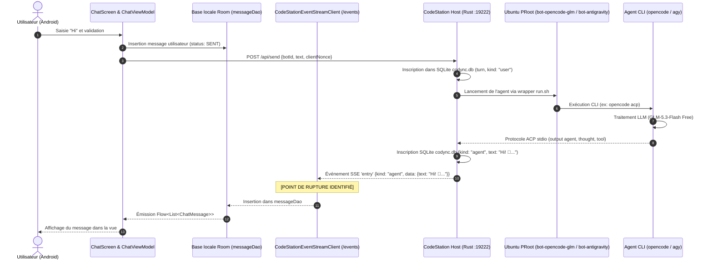

# CodeStation — Journal de Travail (worklog.md)

**Branche de travail :** `fix/agent-execution-and-termux-ui`  
**Date :** 28 Octobre 2026  
**Auteur :** Antigravity AI  

---

## 1. Cartographie des Composants et du Flux d'une Requête



---

## 2. Causes Démontrées des Dysfonctionnements

### Cause 1 : Filtrage erroné des messages dans l'écouteur SSE Android (`CodeStationEventStreamClient.kt:178`)
- **Constat** : Dans le code existant de `CodeStationEventStreamClient.kt`, le filtre d'insertion Room était :
  ```kotlin
  if (text.isNotBlank() && (kind == "assistant" || kind == "notice" || kind == "user"))
  ```
- **Fait démontré dans la base SQLite réelle (`codync.db`)** :
  L'hôte CodeStation enregistre et diffuse les réponses des bots avec `kind = "agent"` (`EntryKind::Agent` dans `host/src/store/model.rs`).
- **Conséquence directe** :
  Lorsque OpenCode a répondu avec succès :
  `"Hi! 👋 I'm OpenCode GLM, ready to help. What would you like to work on today?"` (kind: `"agent"`),
  le client SSE Android a **ignoré et jeté** la réponse. Le message n'a jamais été inséré dans `messageDao`, et l'interface est restée bloquée indéfiniment sur « Réflexion en cours… ».

### Cause 2 : Absence de réinitialisation de `_isBotWorking` et absence de timeout UI
- `ChatViewModel` activait `_isBotWorking.value = true` lors de l'envoi, mais rien ne remettait cette valeur à `false` lorsqu'une réponse était reçue ou lorsque le bot revenait à l'état `IDLE`.
- Aucun délai d'attente (timeout) n'était configuré : si le serveur ou le fournisseur tardait, le spinner tournait indéfiniment.

### Cause 3 : Absence de déclenchement interactif d'une session Termux
- Le serveur CodeStation exécute les agents en arrière-plan via des pipes stdio pour l'API ACP (`Acp::spawn`).
- Aucune commande Intent Android vers Termux (`com.termux.RUN_COMMAND` ou intent d'activité) n'était exposée dans l'interface pour permettre à l'utilisateur d'ouvrir interactivement un terminal dans le conteneur du bot.

### Cause 4 : Déclenchement abusif des notifications et divergence avec `StatusBarPreview`
- Dans `CodeStationEventStreamClient.kt`, le statut `"idle"` du bot était automatiquement mappé à `TaskNotificationPhase.COMPLETED`, provoquant la publication répétée de la notification « Tâche exécutée avec succès » alors même qu'aucune tâche n'avait été exécutée.
- La notification ne reflétait pas le design capsule/pill avec chronomètre visible dans `StatusBarPreview`.

### Cause 5 : Encombrement de l'écran « Connexion Termux »
- Les onglets « Réseau LAN » et « Passerelle » étaient mis en avant alors qu'ils ne sont pas encore opérationnels.
- Les conteneurs de bots étaient relégués tout en bas d'une longue page déroulante, et le jeton d'authentification s'affichait sans masquage.

---

## 3. Plan d'Implémentation des Correctifs

1. **`CodeStationEventStreamClient.kt`** :
   - Accepter `kind == "agent"` et `kind == "assistant"`.
   - Ignorer les messages internes silencieux de passage `(pass)`.
   - Mapper les pensées (`kind == "thought"`) et les exécutions d'outils (`kind == "tool"`).
   - Corriger la détection des approvations (`kind == "permission"`).
   - N'émettre la notification `COMPLETED` que si une transition réelle depuis l'état `WORKING` a eu lieu.

2. **`ChatViewModel.kt`** :
   - Réinitialiser `_isBotWorking` dès qu'un message du bot arrive ou que le bot passe à `IDLE`.
   - Ajouter un timeout configurable (60 secondes) avec message d'avertissement et bouton Réessayer.
   - Corriger `stopTurn()` pour forcer l'arrêt immédiat et insérer un avis d'annulation.

3. **Intégration Session Termux Interactive (`TermuxSessionLauncher.kt`)** :
   - Créer un lanceur dédié capable d'envoyer l'intent Termux `com.termux.RUN_COMMAND` ou d'ouvrir l'application Termux avec la commande prête.
   - Ajouter des boutons explicites « Ouvrir la session Termux » dans l'interface.

4. **Notifications & Barre d'État / Dynamic Island Pill (`CodeStationNotificationManager.kt` & Composant Compose)** :
   - Nettoyer les fausses réussites.
   - Créer le composant `DynamicIslandBar` reproduisant fidèlement `StatusBarPreview` en haut de l'écran.

5. **Restructuration de `PairingScreen.kt`** :
   - Remplacer les onglets non fonctionnels LAN/Passerelle par des onglets clairs :
     1. « Connexion & Diagnostic »
     2. « Conteneurs Ubuntu PRoot »
     3. « Commandes & Ressources »
   - Masquer le jeton par défaut avec icône oeil pour révélation explicite.

---

## 3. Audit et Correction des Espaces Vides Excessifs dans l'Interface Android

**Branche dédiée :** `fix/layout-compactness-and-form-spacing`  
**Date :** 28 Octobre 2026

### A. Diagnostic Technique des Espacements
1. **`Controls.kt` (`CardForm`)** :
   - Hardcoding d'un espacement vertical démesuré de `28.dp` (`Arrangement.spacedBy(28.dp)`) entre chaque section, créant un sentiment de vide immense.
   - Padding interne de ligne de `14.dp` qui cumulait de la hauteur inutilement.
   - **Correction** : Paramètre `verticalSpacing: Dp = 14.dp` et `padding: PaddingValues(horizontal = 16.dp, vertical = 12.dp)`, avec interlignes de `11.dp`.

2. **`SettingsScreen.kt` (« Ordinateurs et paramètres »)** :
   - **Fragmentation excessive** : Huit cartes séparées pour des éléments isolés (une carte pour Thème, une pour Langue, une pour Discussion, une pour Analytics...).
   - **Conflit de disposition des interrupteurs** : `CodyncSwitch` intègre déjà son propre `Spacer(Modifier.weight(1f))`. L'envelopper dans un `Row` externe avec un `Text` portant également `weight(1f)` coupait l'espace 50/50, isolant les interrupteurs dans un vide flottant décalé.
   - **Section Notifications** : Mention de messages push en anglais non configurés qui semaient la confusion.
   - **Version repoussée** : Les informations de build et le bouton de réinitialisation étaient éjectés tout en bas hors de vue.
   - **Correction** :
     - Regroupement en 4 cartes naturelles et compactes (Ordinateurs, Préférences générales, Notifications & Diagnostics, À propos).
     - Interrupteurs `CodyncSwitch` directement associés à leur texte sans conflit de `weight(1f)`.
     - Suppression des avertissements push confus et valorisation des notifications locales / Live Updates réelles d'Android.
     - Version 1.0.3 et lien GitHub immédiatement visibles.

3. **`BotEditorScreen.kt` (« Nouvel Agent »)** :
   - **Empilement démesuré** : 4 cartes moteurs verticales géantes (240dp) + 7 cartes modèles (350dp) occupant 600dp à elles seules, suivies d'un immense vide artificiel lorsque des moteurs plus courts étaient sélectionnés.
   - **Avatar et formulaire séparés** : L'avatar occupait un bloc gigantesque au-dessus des champs d'identité.
   - **Boutons d'action non ancrés** : Le bouton « Créer l'Agent » était abandonné au fond du défilement, invisible sur petit écran ou avec clavier virtuel.
   - **Correction** :
     - Disposition compacte : Avatar (54dp) intégré à gauche du champ « Nom de l'Agent ».
     - Moteurs compacts avec badges d'état et modèles compatibles avec sélecteur clair (badge « Gratuit » pour `GLM-5.3-Flash Free`).
     - Interrupteurs Fast Mode et Pinned directement accolés à leurs descriptions.
     - Barre d'actions inférieure fixe (`Surface` avec `imePadding()` et `navigationBarsPadding()`) garantissant la présence permanente des boutons « Annuler » et « Créer l'Agent ».

---

## 4. Affichage Distinct des Versions Android et Backend

**Date :** 28 Octobre 2026

### A. Implémentation
1. **CodeStation Android** :
   - Activation de `buildFeatures { buildConfig = true }` dans `app/build.gradle.kts`.
   - Lecture réelle du `versionName` (`1.0.3`) et `versionCode` (`4`) via `BuildConfig` et l'API `PackageManager` d'Android.
   - Affichage explicite : `CodeStation Android : 1.0.3 (Build 4)`.

2. **CodeStation Host** :
   - Récupération de la version réelle du backend connecté via `ServerConfig.serverVersion` (alimenté par les routes `/health` et `/hello`).
   - Affichage dynamique :
     - Si connecté avec version vérifiée : `CodeStation Host : 2.28.0` (vert émeraude).
     - Si serveur arrêté ou hors ligne : `CodeStation Host : Indisponible`.

3. **Validation & Tests** :
   - Ajout du fichier de tests unitaires `ComponentVersionsTest.kt` validant la séparation stricte des versions, la détection de l'état déconnecté et la non-pollution mutuelle des versions.
